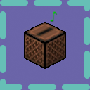

# Ambience (Horizon native mod)



Plays music from a resource pack, chosen by where you are and what you are doing: structures, villages, underwater, biome, dimension, activity, or a generic fallback.

## Recommended packs: Ambience

Use packs in the **Ambience** format (`ambience.properties`). They may define more situations than ReactiveMusic packs:

- events the ReactiveMusic format has no key for: village, boss fight, dying, pumpkin, and the structures (bastion, fortress, stronghold, mineshaft, monument, End city, ancient city, trial chambers);
- specific biomes (`Sunflower+Plains`) and biome tags.

ReactiveMusic (`ReactiveMusic.yaml`) packs are supported too, but this part is less tested. Other ReactiveMusic packs may use other events, and the list may be incomplete or wrong for them.

## Supported tags

**Ambience** (`ambience.properties`): `event.mainMenu`, `boss`, `underground`, `deepUnderground`, `highUp`, `village`, `villageNight`, `underwater`, `minecart`, `boat`, `horse`, `pig`, `night`, `rain`, `dying`, `fishing`, `pumpkinHead`, `nether`, `end`, `generic`, the structures (`bastion`, `fortress`, `stronghold`, `mineshaft`, `monument`, `end_city`, `ancient_city`, `trial_chambers`), `biome.<Name+With+Plus>`, `primarytag.<tag>`, `secondarytag.<tag>`. A value may list several songs separated by commas; one is picked each time the event starts.

Not supported in Ambience: `credits`, `horde`, `bossWither`, `bossDragon` and custom `boss<Name>` events (the mod cannot tell which boss is active).

**ReactiveMusic** (`ReactiveMusic.yaml`): events `MAIN_MENU`, `DAY`, `NIGHT`, `SUNRISE`, `SUNSET`, `RAIN`, `SNOW`, `STORM`, `UNDERWATER`, `UNDERGROUND`, `DEEP_UNDERGROUND`, `HIGH_UP`, `MINECART`, `BOAT`, `HORSE`, `PIG`, `FISHING`, `DYING`, `VILLAGE`, `BOSS`, `OVERWORLD`, `NETHER`, `END`, `GENERIC`, plus `MOUNTAIN`, `BEACH`, `FOREST`. Conditions: `BIOME=name` (part of a name is enough), `BIOMETAG=name` (with or without `IS_`), `DIM=name`, `||` for OR inside one condition, and several conditions in one `events` list must all be true (AND).

Not supported in ReactiveMusic: `CREDITS`, `HOME`, `NEARBY_MOBS`, `BLOCK=` conditions, `allowFallback`, `forceStopMusicOn*`, `forceStartMusicOnValid`, `forceChance`, `alwaysPlay`, `alwaysStop`, `musicSwitchSpeed`, `musicDelayLength`.

Biome tags are matched by keywords in the biome name, so a tag that is not in the mod's list matches nothing.

## Where to get packs

| Pack | Format | Download |
|---|---|---|
| Ambience: RuneScape music pack | Ambience | [CurseForge](https://www.curseforge.com/minecraft/customization/ambience-runescape-music-pack) |
| Ambience: Pokémon Mystery Dungeon Explorers of Sky | Ambience | [CurseForge](https://www.curseforge.com/minecraft/mc-mods/ambience-pokemon-mystery-dungeon-explorers-of-sky) |
| Ambience: Pokémon Red/Blue music pack | Ambience | [CurseForge](https://www.curseforge.com/minecraft/customization/ambience-pokemon-red-blue-music-pack) |
| Adventure Redefined music pack (Ambience) | Ambience | [CurseForge](https://www.curseforge.com/minecraft/customization/adventure-redefined-music-pack-ambience-mod) |
| Zelda music pack for Ambience | Ambience | [CurseForge](https://www.curseforge.com/minecraft/customization/zelda-music-pack-for-ambience) |
| The Legend of Zelda: Twilight Princess music pack | Ambience | [CurseForge](https://www.curseforge.com/minecraft/customization/the-legend-of-zelda-twilight-princess-music-pack) |
| Xenoblade Chronicles music pack (Ambience) | Ambience | [CurseForge](https://www.curseforge.com/minecraft/customization/xenoblade-chronicles-music-pack-ambience) |
| Overlord music pack | Ambience | [CurseForge](https://www.curseforge.com/minecraft/customization/overlord-music-pack) |
| Reactive Music: RuneScape songpack | ReactiveMusic | [CurseForge](https://www.curseforge.com/minecraft/texture-packs/reactive-music-runescape-songpack) |

## Installing a pack

Put the pack in `resourcepacks/` as a folder or a `.zip`. The mod reads `.zip` files directly; they are never changed or deleted. Pick the pack in Options > Mods > Ambience, or leave it on auto (the first pack found).

All tracks are converted once with **ffmpeg** (with libvorbis on the PATH) and loudness-normalised to -16 LUFS, so packs sound equally loud. Each converted file is checked with **ffprobe** when it is available. The converted files go to `.horizon-cache/ambience/packs/<pack>/sounds` in the game folder. The next start checks the cache and converts nothing if it matches.

## Settings

Options > Mods > Ambience:

- **Ambience**: on or off. Off removes the converted tracks and the cache.
- **Pack**: auto or one of the packs in `resourcepacks/`.
- **Pack menu and boss music**: use the pack on the title screen and in boss fights.
- **Stop music in the pause menu**: off (default) pauses the music and resumes it where it stopped; on stops it instead.
- **Crossfade between tracks**: seconds of fade between tracks (default 2; 0 = cut).
- **Resume the last track within**: a track left for a short time carries on from where it stopped (default 5 s; 0 = off).
- **Volume**: 25, 50, 75 or 100 percent (default 100). The mod's music uses the Records (jukebox and note block) volume slider, which is what lets the game pause it.
- **Fallback pack**: a second Ambience pack (off by default). Its tracks play only in situations the main pack has no track for.
- **Custom rules**: read `ambience/rules.yaml` in the game folder (ReactiveMusic format) before the pack's rules.

## Commands

- `/ambience`: usage. `/ambience status`: what is playing and why.
- `/ambience packs`, `/ambience pack <name|auto>`: list and choose packs.
- `/ambience tracks`: tracks of the loaded pack and whether they are converted.
- `/ambience play <track>`, `/ambience play off`: play one track, or hand control back.
- `/ambience on`, `/ambience off`, `/ambience reload`, `/ambience convert`.
- `/ambience selftest`: checks the pack, converted tracks, ffmpeg, ffprobe and sound registration.

## Build

```sh
horizon-launcher native-build . --trust-native-code
```

## Credits

The idea comes from the [Ambience](https://github.com/VazkiiModsArchive/Ambience) music mod, licensed under [CC BY-NC-SA 3.0](https://creativecommons.org/licenses/by-nc-sa/3.0/deed.en_GB). This is a separate implementation for Horizon, written from scratch; the original code was not reused.

## License

MIT. See [LICENSE](LICENSE).